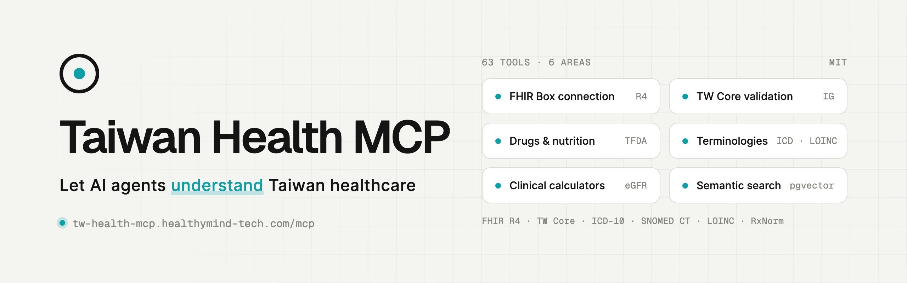
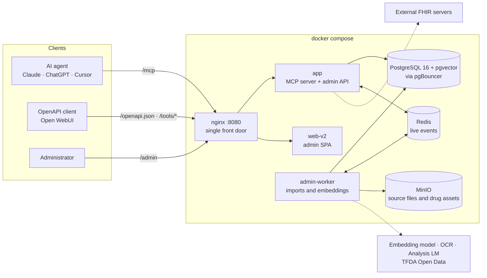

<p align="center">
  <picture>
    <source media="(prefers-color-scheme: dark)" srcset=".github/assets/readme-banner-en-dark.png">
    
  </picture>
</p>

<h1 align="center">Taiwan Health MCP Server</h1>

<p align="center">
  <a href="README.md">繁體中文</a> · <b>English</b>
</p>

<p align="center">
  An MCP server for Taiwan medical and health data<br>
  ICD-10-CM/PCS, SNOMED CT, LOINC, Taiwan FDA drugs / health supplements / food nutrition, and FHIR R4 IG authoring and validation tools
</p>

<p align="center">
  <a href="https://tw-health-mcp.healthymind-tech.com/en">Website</a> ·
  <a href="https://healthymind-tech.github.io/Taiwan-Health-MCP/en/">Docs</a> ·
  <a href="#quick-connect">Quick connect</a> ·
  <a href="#self-hosting">Self-hosting</a>
</p>

<div align="center">

[](https://tw-health-mcp.healthymind-tech.com/en)
[](#six-areas)
[](https://tw-health-mcp.healthymind-tech.com/en)
[](https://github.com/healthymind-tech/Taiwan-Health-MCP/stargazers)
[](LICENSE)

</div>

<!-- demo video goes here -->

A Node.js server built on the official **TypeScript MCP SDK** (`@modelcontextprotocol/sdk`), exposing **70 tools** across 12 tool groups. Designed for high-throughput production SaaS deployments.

## Quick connect

To skip self-hosting, connect to the public endpoint `https://tw-health-mcp.healthymind-tech.com/mcp` (MCP streamable-http).

[](https://cursor.com/en/install-mcp?name=taiwan-health&config=eyJ1cmwiOiJodHRwczovL3R3LWhlYWx0aC1tY3AuaGVhbHRoeW1pbmQtdGVjaC5jb20vbWNwIn0=)
[](https://insiders.vscode.dev/redirect/mcp/install?name=taiwan-health&config=%7B%22type%22%3A%22http%22%2C%22url%22%3A%22https%3A%2F%2Ftw-health-mcp.healthymind-tech.com%2Fmcp%22%7D)

**Claude Code**

```bash
claude mcp add --transport http taiwan-health https://tw-health-mcp.healthymind-tech.com/mcp
```

**Claude Desktop / claude.ai**: under Settings → Connectors, add a custom connector and paste the endpoint URL above.

Any other client that supports MCP streamable-http takes the same URL. To run it in your own environment, see [Self-hosting](#self-hosting).

## Six areas

<table>
<tr>
<td width="33%" valign="top">

**FHIR Box connection** · 3 tools

Once an administrator registers a hospital FHIR Box or any FHIR R4 server, AI agents can query and read its resources

`crud_fhir_server`<br>`get_fhir_server_status`

[Docs →](https://healthymind-tech.github.io/Taiwan-Health-MCP/en/tools/fhir-server-tools/)

</td>
<td width="33%" valign="top">

**TW Core validation & grounding** · 26 tools

Multi-IG profiles and ValueSets, skeleton-fill resource generation, validation aligned with HL7 `validator_cli` 7.0.1, and LLM-free checks that a record stays faithful to its source

`fhir_validate_resource`<br>`fhir_check_grounding`

[Docs →](https://healthymind-tech.github.io/Taiwan-Health-MCP/en/tools/fhir-ig-tools/)

</td>
<td width="33%" valign="top">

**Taiwan drugs & nutrition** · 9 tools

TFDA drug licences, package-insert OCR, pill identification by imprint / colour / shape, plus Taiwan FDA health supplements and food nutrient data

`identify_unknown_pill`<br>`query_food_nutrition`

[Docs →](https://healthymind-tech.github.io/Taiwan-Health-MCP/en/tools/drug-tools/)

</td>
</tr>
<tr>
<td valign="top">

**International terminologies** · 13 tools

ICD-10-CM / PCS (CMS 2026-04-01), SNOMED CT International, LOINC 2.80 and RxNorm: code lookup, cross-terminology mapping and lab result interpretation

`search_medical_codes`<br>`interpret_lab_result`

[Docs →](https://healthymind-tech.github.io/Taiwan-Health-MCP/en/tools/icd-tools/)

</td>
<td valign="top">

**Clinical calculators** · 11 tools

CHA₂DS₂-VASc, Wells, HAS-BLED, CURB-65, qSOFA, GCS, eGFR, DAS28, CDAI and BMI (Taiwan cut-offs); deterministic, so the LLM never does the arithmetic

`calculate_egfr`<br>`calculate_chads2_vasc`

[Docs →](https://healthymind-tech.github.io/Taiwan-Health-MCP/en/tools/clinical-calculator-tools/)

</td>
<td valign="top">

**Semantic search** · cross-module

Hybrid search over ICD-10, LOINC, SNOMED CT and IG CodeSystems with pgvector embeddings (Ollama `qwen3-embedding` by default); falls back to keyword search without embeddings

`search_loinc`<br>`fhir_normalize_code`

[Docs →](https://healthymind-tech.github.io/Taiwan-Health-MCP/en/modules/ig-concept-search/)

</td>
</tr>
</table>

<details>
<summary><b>All 70 tools</b></summary>

| Group | Tools |
|-------|-------|
| ICD-10 | `search_medical_codes`, `infer_complications`, `get_nearby_codes`, `check_medical_conflict`, `browse_icd_category` |
| Drugs / TFDA | `search_drug`, `identify_unknown_pill`, `get_drug_details`, `get_drug_asset_links` |
| Lab / LOINC | `search_loinc`, `query_loinc`, `interpret_lab_result`, `batch_interpret_lab_results` |
| SNOMED CT | `search_snomed_concept`, `query_snomed_concept`, `get_snomed_relationships`, `query_snomed_mapping` |
| FHIR Condition | `query_fhir_condition`, `validate_fhir_condition` |
| FHIR Medication | `query_fhir_medication`, `validate_fhir_medication` |
| FHIR IG (authoring / validation) | `fhir_list_igs`, `fhir_get_ig`, `fhir_list_artifacts`, `fhir_search_artifacts`, `fhir_list_resource_profiles`, `fhir_rank_resource_profiles`, `fhir_get_profile`, `fhir_get_profile_elements`, `fhir_get_profile_required_elements`, `fhir_get_valueset`, `fhir_expand_valueset`, `fhir_lookup_code`, `fhir_validate_code`, `fhir_normalize_code`, `fhir_resolve_reference`, `fhir_build_bundle`, `fhir_validate_resource`, `fhir_validate_bundle`, `fhir_get_resource_skeleton`, `fhir_finalize_resource`, `fhir_finalize_bundle`, `fhir_check_grounding`, `fhir_check_completeness`, `fhir_get_authoring_fields`, `fhir_author_resources`, `fhir_context`, `fhir_assemble_bundle`, `fhir_get_bundle_blueprint`, `fhir_get_minimal_skeleton` |
| Health supplements | `search_health_supplements` |
| Food nutrition | `query_food_nutrition`, `query_food_ingredient`, `search_foods_by_nutrient`, `analyze_meal_nutrition` |
| FHIR servers | `list_fhir_servers`, `get_fhir_server_status`, `crud_fhir_server` |
| Clinical calculators | `calculate_chads2_vasc`, `calculate_wells_pe`, `calculate_wells_dvt`, `calculate_das28`, `calculate_cdai`, `calculate_bmi`, `calculate_egfr`, `calculate_has_bled`, `calculate_curb65`, `calculate_qsofa`, `calculate_gcs` |
| System | `health_check` |

- Module tools are enabled / disabled automatically by each module's data-load status (for example, with health supplements and food nutrition not loaded, `/openapi.json` lists 58); FHIR server, clinical calculator and system tools are always registered. The admin console's MCP tools page (`/admin/mcp`) lists all 70 tools, why any is not registered, and lets you try a call.
- Every tool except `crud_fhir_server` is read-only. `crud_fhir_server` can write (create / update / patch / delete) to an external FHIR server **registered by an administrator**, only when that server's allow-list permits it and the caller passes `confirm_write=true`.
- A tool showing as available only means its source data is loaded, not that its embeddings are complete. Check the Embeddings count on each module page in the admin console (e.g. ICD-10 / LOINC / SNOMED under 醫療術語); until they are complete, search falls back to or mixes in keyword/BM25 (responses carry `search_mode: "keyword_only"`).
- Terminology coverage: ICD-10-CM (the complete CMS 2026-04-01 code set, incl. 7th characters) / ICD-10-PCS, WHO ICD-10 (optional), SNOMED CT International (incl. inactive content and historical associations), LOINC 2.80 (incl. answer / part / panel), RxNorm, FHIR R4; the built-in validator also supports CVX, ISO 3166 and UCUM. Validator audit: [`node-server/scripts/validator-audit/`](node-server/scripts/validator-audit/).

</details>

## Architecture



- The backend is entirely **Node.js / TypeScript** ([`node-server/`](node-server/)): `app` serves MCP and the admin API, `admin-worker` runs every import and embedding job. There is no Python runtime dependency.
- The admin console is a Vite + React + Mantine SPA ([`web-v2/`](web-v2/)); the old Next.js `web/` is kept only in the compose profile `legacy-web` for rollback.
- Tools register automatically by each module's data-load status; when the embedding model is unreachable, search falls back to keywords.
- Metrics are exported in Prometheus format (`METRICS_PORT`, bound to localhost by default).
- The landing and legal pages (`/`, `/status`, `/privacy`, `/dpa`) are served by the separate [website](https://tw-health-mcp.healthymind-tech.com/en), not this project.

## Self-hosting

```bash
git clone https://github.com/healthymind-tech/Taiwan-Health-MCP.git
cd Taiwan-Health-MCP
cp .env.example .env                          # set POSTGRES_PASSWORD, ADMIN_*, etc.
docker compose up -d
```

The MCP endpoint is then `http://<host>:8080/mcp`; sign in at `http://<host>:8080/admin` to import data. Full guide: [Deployment](docs/deployment/index.en.md).

<details>
<summary><b>Services and redeploying</b></summary>

| Service | Description |
|---------|-------------|
| `nginx` | **Single public entry point**, default `:8080` (`WEB_PORT`) |
| `web-v2` | Admin SPA (static Vite build served by the container's nginx); the front door sends `/admin` and every other page here |
| `app` | Node MCP server + admin REST API (`node dist/server.js`; internal network only, no host port) |
| `admin-worker` | Background job runner (every import and embedding job, `node dist/admin/adminWorker.js`) |
| `postgres` | PostgreSQL 16 + pgvector |
| `pgbouncer` | Connection pooler (transaction mode) |
| `redis` | Pub/sub relay for the admin console's live events and health checks; no tool response is cached today |
| `minio` + `minio-init` | Object storage (source files uploaded in the admin console, drug assets) |

The old Next.js `web` service is in the compose profile `legacy-web`; `docker compose up -d` does not start it (rollback only).

> **Important**: the `app` container **does not publish port 8000** to the host; all traffic must go through nginx. Always use `http://<host>:8080` (or your `WEB_PORT`).

Redeploy after code changes:

```bash
docker compose build app admin-worker web-v2 && docker compose up -d --no-deps app admin-worker web-v2
```

`admin-worker` is a separate image (`Dockerfile.worker`); rebuilding only `app` leaves the worker running old import code. For `health_check` to report the git sha, set it at build time: `BUILD_SHA=$(git rev-parse --short HEAD) docker compose build app admin-worker` (`compose.yaml` passes it as a build arg; `dev` when unset).

</details>

<details>
<summary><b>Loading data (through the admin console)</b></summary>

Imports are started in the **Admin Console** and run in the background by `admin-worker` (there is no standalone CLI data-loader container).

1. The admin console is on by default (`ADMIN_ENABLED=true`). Set the sign-in details in `.env`:

   ```dotenv
   ADMIN_USERNAME=admin
   # Plain-text password used once on first start (hashed into admin.admin_credentials and
   # never overwritten; delete this line afterwards and change it under 帳號安全 in the console).
   ADMIN_INITIAL_PASSWORD=change-me
   # Required: the server refuses to start while this is still the example value (openssl rand -hex 32)
   ADMIN_SESSION_SECRET=...
   ```

   You can use `ADMIN_PASSWORD_HASH` instead (`sha256$<hex>` or `pbkdf2_sha256$<iterations>$<salt>$<hex>`; write every `$` as `$$` in `.env`). After `docker compose up -d`, sign in at `http://<host>:8080/admin`.

2. Import data on each module page (sidebar: 醫療術語, 藥品, 健康食品, 食品營養, IG 套件庫):

   - **Upload a source file** (upload, then import): ICD-10-CM (CMS order file zip) / ICD-10-PCS, WHO ICD-10 (optional), LOINC, SNOMED CT, RxNorm; FHIR IGs install from the package registry or from an uploaded `package.tgz` (missing dependencies are downloaded automatically).
   - **Fetched from an API** (import directly or schedule): drugs (TFDA, three stages: index → crawl and enrich → OCR/LLM analysis), health supplements, food nutrition.

3. Embeddings (semantic search) are separate `*_embed` jobs, run from each module page. The embedding and analysis LLM endpoints are configured on the **模型端點** (model endpoints) page (provider accounts + routes, stored in `admin.llm_providers` / `admin.llm_routes` and related tables), and OCR (MinerU) on the **外部服務** (external services) page; neither is read from environment variables.

Import progress, the step timeline and live logs are on the **背景工作** (jobs) page. The console also browses terminologies, manages external FHIR servers, shows the MCP tools and handles backups; once data is loaded you can set `ADMIN_ENABLED=false` to shrink a public deployment's attack surface, and MCP tools, the worker and scheduled imports keep running. See the [admin console docs](docs/admin/index.en.md) and [jobs and worker](docs/admin/jobs-and-worker.en.md).

</details>

<details>
<summary><b>Client interfaces and authentication</b></summary>

Both interfaces are served through the nginx front door (default `:8080`):

| Interface | Endpoint | For |
|-----------|----------|-----|
| **MCP** (streamable-http) | `http://<host>:8080/mcp` | Native MCP clients (Claude Desktop, Open WebUI v0.6.31+ MCP connections, etc.) |
| **OpenAPI bridge** | `GET http://<host>:8080/openapi.json`, `POST http://<host>:8080/tools/<tool name>` | Clients that only support OpenAPI tool servers (e.g. Open WebUI External Tools / OpenAPI type) |

`/openapi.json` is generated from the currently enabled tools as an OpenAPI 3.1 document; each tool maps to `POST /tools/<tool name>` with its arguments as the JSON body. A client only needs the base URL `http://<host>:8080` and fetches `/openapi.json` itself.

> Authentication: the default is `PUBLIC_TOOLS_AUTH_MODE=none` (no auth, trusted networks only). When exposing it publicly, set `PUBLIC_TOOLS_AUTH_MODE=bearer` and `PUBLIC_TOOLS_BEARER_TOKEN`; all three endpoints (`/mcp`, `/openapi.json`, `/tools/*`) then require `Authorization: Bearer <token>`, and `PUBLIC_TOOLS_CORS_ORIGINS` may not contain `*` in bearer mode.

</details>

<details>
<summary><b>Database schema</b></summary>

`audit` | `admin` | `icd` | `drug` | `health_supplements` | `food_nutrition` | `loinc` | `fhir` (multi-IG) | `snomed` | `rxnorm`

The full definition is `db/schema.sql` (applied automatically when the PostgreSQL container first starts with an empty data volume); incremental changes are in `db/migrations/`. **There is no migration runner**: apply them by hand to an existing database in filename-date order (e.g. `psql -U mcp -d taiwan_health -f db/migrations/20261020_loinc_structure.sql`).

</details>

<details>
<summary><b>Development</b></summary>

```bash
# Backend (MCP + admin REST + worker)
cd node-server
npm install
npm run build          # tsc -> dist/
npm run typecheck      # tsc --noEmit
npm test               # node --test (node-server/src/**/*.test.ts)

# Admin SPA (Vite)
cd web-v2
npm install
npm run dev            # http://localhost:5173/admin/, proxies the API to ADMIN_BACKEND (default http://127.0.0.1:8090)
npm run build          # tsc -b && vite build -> dist/
npm run typecheck
```

See the [development guide](docs/development/index.en.md) and [testing guide](docs/development/testing.en.md).

</details>

## Documentation

The full documentation is in [`docs/`](docs/) and published with MkDocs on [GitHub Pages](https://healthymind-tech.github.io/Taiwan-Health-MCP/en/) (configured in `mkdocs.yml`).

## Acknowledgements

- Ministry of Health and Welfare, Taiwan; Taiwan FDA (TFDA)
- Regenstrief Institute (LOINC)
- SNOMED International
- National Library of Medicine (RxNorm / UMLS)
- HL7 International (FHIR)
- WHO
