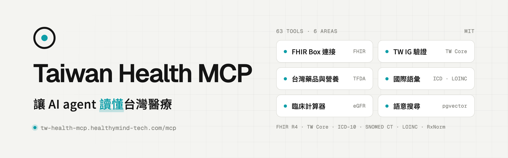

<p align="center">
  <picture>
    <source media="(prefers-color-scheme: dark)" srcset=".github/assets/readme-banner-dark.png">
    
  </picture>
</p>

<h1 align="center">Taiwan Health MCP Server</h1>

<p align="center">
  台灣醫療健康資料整合 MCP 伺服器<br>
  整合 ICD-10-CM/PCS、SNOMED CT、LOINC、台灣 FDA 藥品 / 健康補充品 / 食品營養，以及 FHIR R4 IG 授權與驗證工具
</p>

<p align="center">
  <a href="https://tw-health-mcp.healthymind-tech.com">官網</a> ·
  <a href="https://healthymind-tech.github.io/Taiwan-Health-MCP">文件</a> ·
  <a href="#快速連線">快速連線</a> ·
  <a href="#快速開始">自行部署</a>
</p>

<div align="center">

[](https://tw-health-mcp.healthymind-tech.com)
[](#工具群組)
[](https://tw-health-mcp.healthymind-tech.com)
[](https://github.com/healthymind-tech/Taiwan-Health-MCP/stargazers)
[](http://hl7.org/fhir/R4/)
[](https://nodejs.org/)
[](https://www.typescriptlang.org/)
[](https://modelcontextprotocol.io)
[](LICENSE)

</div>


以官方 **TypeScript MCP SDK**（`@modelcontextprotocol/sdk`）建構的 Node.js 伺服器，對外提供 **63 個工具**，涵蓋 12 個工具群組。專為高吞吐量的生產級 SaaS 部署設計。

> **後端執行環境**：整個後端（MCP server、管理後台 REST API、背景 worker、所有資料載入器）皆為 **Node.js / TypeScript**，程式碼位於 [`node-server/`](node-server/)。管理後台前端為 Vite + React + Mantine 的 SPA，位於 [`web-v2/`](web-v2/)，由自己的 nginx 容器 `web-v2` 提供（舊的 Next.js `web/` 僅保留於 compose profile `legacy-web` 供回滾，預設不啟動）。本專案已無 Python 執行期相依。
> 對外的宣傳頁與法務頁（`/`、`/status`、`/privacy`、`/dpa`）已移出本專案，改由獨立的宣傳網站提供。

## 專案特色

- **台灣在地化資料**：台灣 FDA 藥品（含仿單 / 外觀 / OCR + LLM 分析）、健康補充品、食品營養、TWCore IG。
- **國際術語支援**：ICD-10-CM（CMS 2026-04-01 完整碼表，含第 7 碼）/ ICD-10-PCS、WHO ICD-10（選用）、SNOMED CT International（含 inactive 內容與歷史關聯）、LOINC 2.80（含 answer / part / panel）、RxNorm、FHIR R4；內建 validator 另支援 CVX、ISO 3166、UCUM。
- **FHIR IG 授權工具**：多 IG（package-scoped、版本感知）剖面 / ValueSet 查詢、術語驗證、骨架填值（skeleton-fill）資源產生與驗證；內建 validator 以 HL7 `validator_cli` 7.0.1 為對齊目標（稽核見 [`node-server/scripts/validator-audit/`](node-server/scripts/validator-audit/)）；另有確定性（不用 LLM）的病歷忠實度檢查 `fhir_check_grounding` / `fhir_check_completeness`。
- **語意 / 混合搜尋**：以嵌入模型（預設 Ollama `qwen3-embedding`）為基礎，無嵌入時自動退回關鍵字搜尋。
- **動態工具啟用**：依各模組資料載入狀態自動註冊 / 移除可用 MCP 工具。
- **管理後台**：Admin Console（上傳來源檔、執行 / 排程匯入、術語瀏覽、模型端點（provider 帳號 + 路由）、MCP 工具目錄與線上測試、外部 FHIR 伺服器、備份與設定匯出匯入、即時監控背景工作）。
- **生產部署設計**：PostgreSQL 16（pgvector）、pgBouncer、Redis、MinIO、Prometheus、背景 worker，前置 nginx 單一入口。

> 工具顯示為 available 只代表來源資料已載入，不代表 embedding 已完整。請在管理後台各模組頁（如「醫療術語」底下的 ICD-10 / LOINC / SNOMED）檢查 Embeddings 計數；未完成時搜尋會退回或混用 keyword/BM25（回應會標 `search_mode: "keyword_only"`）。

## 快速連線

不想自己架設，可以直接連官方端點 `https://tw-health-mcp.healthymind-tech.com/mcp`（MCP streamable-http）。

[](https://cursor.com/en/install-mcp?name=taiwan-health&config=eyJ1cmwiOiJodHRwczovL3R3LWhlYWx0aC1tY3AuaGVhbHRoeW1pbmQtdGVjaC5jb20vbWNwIn0=)
[](https://insiders.vscode.dev/redirect/mcp/install?name=taiwan-health&config=%7B%22type%22%3A%22http%22%2C%22url%22%3A%22https%3A%2F%2Ftw-health-mcp.healthymind-tech.com%2Fmcp%22%7D)

**Claude Code**

```bash
claude mcp add --transport http taiwan-health https://tw-health-mcp.healthymind-tech.com/mcp
```

**Claude Desktop / claude.ai**：在「設定 → 連接器」新增自訂連接器，貼上上面的端點網址。

其他支援 MCP streamable-http 的客戶端，填入同一個網址即可。要在自己的環境部署，請看下一節。

## 快速開始

```bash
git clone https://github.com/healthymind-tech/Taiwan-Health-MCP.git
cd Taiwan-Health-MCP
cp .env.example .env                          # 設定 POSTGRES_PASSWORD、ADMIN_* 等
docker compose up -d
```

`docker compose up -d` 會啟動：

| 服務 | 說明 |
|------|------|
| `nginx` | **單一對外入口**，預設 `:8080`（`WEB_PORT`） |
| `web-v2` | 管理後台 SPA（Vite 靜態檔，由容器內 nginx 提供）；前門把 `/admin` 與其餘頁面導到這裡 |
| `app` | Node MCP 伺服器 + 管理後台 REST API（`node dist/server.js`；只在內部網路，不對主機開埠） |
| `admin-worker` | 背景工作執行器（所有匯入與嵌入工作，`node dist/admin/adminWorker.js`） |
| `postgres` | PostgreSQL 16 + pgvector |
| `pgbouncer` | 連線池（transaction mode） |
| `redis` | 管理後台即時事件的 pub/sub 轉送與健康檢查；目前沒有任何工具回應被快取 |
| `minio` + `minio-init` | 物件儲存（管理後台上傳的來源檔、藥品資產） |

舊的 Next.js `web` 服務屬於 compose profile `legacy-web`，`docker compose up -d` 不會啟動它（僅供回滾）。

> **重要**：`app` 容器**不對主機開放 8000 埠**，所有流量都必須經過 nginx。請一律使用 `http://<host>:8080`（或你設定的 `WEB_PORT`）。

程式碼變更後重新部署：

```bash
docker compose build app admin-worker web-v2 && docker compose up -d --no-deps app admin-worker web-v2
```

`admin-worker` 是另一個映像（`Dockerfile.worker`），只重建 `app` 會讓 worker 繼續跑舊的匯入程式碼。要讓 `health_check` 回報 git sha，建置時設定環境變數：`BUILD_SHA=$(git rev-parse --short HEAD) docker compose build app admin-worker`（`compose.yaml` 會把它當 build arg 傳入，未設定時為 `dev`）。詳見[部署指南](docs/deployment/index.md)。

## 載入資料（透過管理後台）

資料匯入由 **Admin Console** 觸發、交由 `admin-worker` 背景執行（無獨立的 CLI data-loader 容器）。

1. 管理後台預設啟用（`ADMIN_ENABLED=true`）。在 `.env` 設定登入資訊：

   ```dotenv
   ADMIN_USERNAME=admin
   # 首次啟動時以此明文密碼建立帳密（雜湊後存入 admin.admin_credentials，之後不再覆寫；
   # 建立後請刪除這行，改密碼請到管理後台「帳號安全」）。
   ADMIN_INITIAL_PASSWORD=change-me
   # 必改：仍為範例值時伺服器拒絕啟動（openssl rand -hex 32）
   ADMIN_SESSION_SECRET=...
   ```

   也可改用 `ADMIN_PASSWORD_HASH`（`sha256$<hex>` 或 `pbkdf2_sha256$<iterations>$<salt>$<hex>`；在 `.env` 中每個 `$` 要寫成 `$$`）。啟動後（`docker compose up -d`），於 `http://<host>:8080/admin` 登入。

2. 在各模組頁（側邊欄「醫療術語」、「藥品」、「健康食品」、「食品營養」、「IG 套件庫」）匯入資料：

   - **需上傳來源檔**（上傳後按匯入）：ICD-10-CM（CMS order file zip）/ ICD-10-PCS、WHO ICD-10（選用）、LOINC、SNOMED CT、RxNorm；FHIR IG 可由套件 registry 安裝或上傳 `package.tgz`（缺少的相依套件會自動下載）。
   - **由 API 自動抓取**（直接按匯入或設定排程）：藥品（TFDA，三階段：索引 → 爬取豐富 → OCR/LLM 分析）、健康補充品、食品營養。

3. 嵌入（語意搜尋）為獨立的 `*_embed` 工作，可於各模組頁面執行。嵌入與分析 LLM 的端點在「**模型端點**」頁設定（provider 帳號 + 路由，存於 `admin.llm_providers` / `admin.llm_routes` 等表），OCR（MinerU）在「**外部服務**」頁設定；兩者都**不透過環境變數**。

匯入進度、步驟時間軸與即時日誌可在「**背景工作**」頁查看。詳見[管理後台文件](docs/admin/index.md)與[背景工作與排程](docs/admin/jobs-and-worker.md)。

## 工具群組

| 群組 | 工具 |
|------|------|
| ICD-10 | `search_medical_codes`、`infer_complications`、`get_nearby_codes`、`check_medical_conflict`、`browse_icd_category` |
| 藥品 / TFDA | `search_drug`、`identify_unknown_pill`、`get_drug_details`、`get_drug_asset_links` |
| 檢驗 / LOINC | `search_loinc`、`query_loinc`、`interpret_lab_result`、`batch_interpret_lab_results` |
| SNOMED CT | `search_snomed_concept`、`query_snomed_concept`、`get_snomed_relationships`、`query_snomed_mapping` |
| FHIR Condition | `query_fhir_condition`、`validate_fhir_condition` |
| FHIR Medication | `query_fhir_medication`、`validate_fhir_medication` |
| FHIR IG（授權 / 驗證） | `fhir_list_igs`、`fhir_get_ig`、`fhir_list_artifacts`、`fhir_search_artifacts`、`fhir_list_resource_profiles`、`fhir_rank_resource_profiles`、`fhir_get_profile`、`fhir_get_profile_elements`、`fhir_get_profile_required_elements`、`fhir_get_valueset`、`fhir_expand_valueset`、`fhir_lookup_code`、`fhir_validate_code`、`fhir_normalize_code`、`fhir_resolve_reference`、`fhir_build_bundle`、`fhir_validate_resource`、`fhir_validate_bundle`、`fhir_get_resource_skeleton`、`fhir_finalize_resource`、`fhir_check_grounding`、`fhir_check_completeness` |
| 健康補充品 | `search_health_supplements` |
| 食品營養 | `query_food_nutrition`、`query_food_ingredient`、`search_foods_by_nutrient`、`analyze_meal_nutrition` |
| FHIR 伺服器 | `list_fhir_servers`、`get_fhir_server_status`、`crud_fhir_server` |
| 臨床計算器 | `calculate_chads2_vasc`、`calculate_wells_pe`、`calculate_wells_dvt`、`calculate_das28`、`calculate_cdai`、`calculate_bmi`、`calculate_egfr`、`calculate_has_bled`、`calculate_curb65`、`calculate_qsofa`、`calculate_gcs` |
| 系統 | `health_check` |

> 模組相關工具會依資料載入狀態自動啟用 / 停用（例如健康補充品、食品營養未載入時，`/openapi.json` 只會列出 58 個）；FHIR 伺服器、臨床計算器與系統工具則永遠註冊。管理後台「MCP 工具」頁（`/admin/mcp`）列出全部 63 個工具、未註冊的原因，並可線上試呼叫。
>
> 除 `crud_fhir_server` 外，所有工具皆為唯讀。`crud_fhir_server` 可對**已由管理者登錄**的外部 FHIR 伺服器執行寫入（create / update / patch / delete），且必須該伺服器的 allow-list 允許、呼叫端並帶入 `confirm_write=true`。

## 連接客戶端

兩種介面都經由 nginx 前門提供（預設 `:8080`）：

| 介面 | 端點 | 適用客戶端 |
|------|------|-----------|
| **MCP**（streamable-http） | `http://<host>:8080/mcp` | 原生 MCP 客戶端（Claude Desktop、Open WebUI v0.6.31+ 的 MCP 連線等） |
| **OpenAPI bridge** | `GET http://<host>:8080/openapi.json`、`POST http://<host>:8080/tools/<工具名>` | 僅支援 OpenAPI 工具伺服器的客戶端（如 Open WebUI 的 External Tools / OpenAPI 類型） |

`/openapi.json` 依「目前已啟用的工具」動態產生 OpenAPI 3.1 規格；每個工具對應 `POST /tools/<工具名>`，以 JSON body 當參數呼叫。客戶端只要填基底網址 `http://<host>:8080`，即會自動抓取 `/openapi.json`。

> 驗證：預設 `PUBLIC_TOOLS_AUTH_MODE=none`（不驗證，僅適合可信網路）。對外開放時設 `PUBLIC_TOOLS_AUTH_MODE=bearer` 與 `PUBLIC_TOOLS_BEARER_TOKEN`，三個端點（`/mcp`、`/openapi.json`、`/tools/*`）會一起要求 `Authorization: Bearer <token>`；`PUBLIC_TOOLS_CORS_ORIGINS` 在 bearer 模式下不可含 `*`。

## 資料庫 Schema

`audit` | `admin` | `icd` | `drug` | `health_supplements` | `food_nutrition` | `loinc` | `fhir`（multi-IG）| `snomed` | `rxnorm`

完整定義見 `db/schema.sql`（PostgreSQL 容器首次啟動、資料卷為空時自動套用），增量變更見 `db/migrations/`。**沒有 migration runner**：既有資料庫須依檔名日期順序手動套用（例如 `psql -U mcp -d taiwan_health -f db/migrations/20261020_loinc_structure.sql`）。

## 管理後台

預設啟用（`ADMIN_ENABLED=true`，這是匯入資料的唯一途徑）；資料載入完成後可設為 `false` 縮小公開部署的攻擊面，MCP 工具、worker 與排程匯入照常運作。於 `/admin` 存取，用於上傳來源檔、執行與排程資料匯入、瀏覽術語、設定模型端點與外部服務、管理外部 FHIR 伺服器、檢視 MCP 工具，以及監控由 `admin-worker` 執行的背景工作。詳見 [`docs/admin/`](docs/admin/index.md)。

## 開發

```bash
# 後端（MCP + admin REST + worker）
cd node-server
npm install
npm run build          # tsc -> dist/
npm run typecheck      # tsc --noEmit
npm test               # node --test（node-server/src/**/*.test.ts）

# 管理後台 SPA（Vite）
cd web-v2
npm install
npm run dev            # http://localhost:5173/admin/，API 代理到 ADMIN_BACKEND（預設 http://127.0.0.1:8090）
npm run build          # tsc -b && vite build -> dist/
npm run typecheck
```

詳見[開發指南](docs/development/index.md)與[測試指南](docs/development/testing.md)。

## 文件

完整文件請見 [`docs/`](docs/)，線上版由 MkDocs 發佈於 [GitHub Pages](https://healthymind-tech.github.io/Taiwan-Health-MCP)（設定見 `mkdocs.yml`）。

## 致謝

- 台灣衛生福利部、TFDA
- Regenstrief Institute（LOINC）
- SNOMED International
- National Library of Medicine（RxNorm / UMLS）
- HL7 International（FHIR）
- WHO
