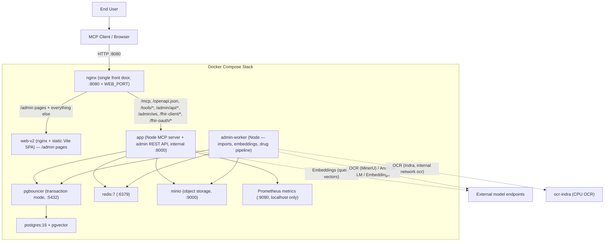

# Deployment Architecture

## Key considerations

1. **Single entry point**: nginx is the only service intended for host access (`WEB_PORT`, 8080 by default). `app` only has `expose`, no `ports`, so `:8000` cannot be reached from the host.
2. **Data persistence**: PostgreSQL and MinIO data live in Docker volumes, so the data survives container restarts and needs no re-import.
3. **Transport**: always `streamable-http` (through nginx's `/mcp`). It is the only transport the server offers; there is no stdio mode.
4. **pgBouncer transaction mode**: incompatible with `LISTEN/NOTIFY` and named prepared statements; the Node side uses `pg`'s unnamed statements for compatibility.
5. **Data imports**: triggered from the admin console and executed in the background by `admin-worker` (there is no longer a standalone data-loader container). Source files are uploaded to MinIO through the admin console and fetched back when a job runs.
6. **MinIO**: stores drug document assets (inserts / labels / pill images); the tools return time-limited presigned download links.
7. **External model endpoints**: embeddings, OCR (MinerU), and the analysis LLM are all external HTTP services (OCR can instead use the bundled CPU OCR container `ocr-indra`, which sits on an internal-only network). Embedding and analysis-LLM endpoints live in the provider-account / profile tables (`admin.llm_providers`, `llm_routes`, `llm_route_members`, `llm_role_routes`) and are configured on the console's Model endpoints page; OCR lives in the `ocr` group of `admin.app_settings` and is configured under External services. When unavailable, the system degrades (search falls back to keywords and is stamped `search_mode: "keyword_only"`; analysis jobs pause and retry automatically, without affecting queries).
8. **Legacy front-end**: the Next.js `web` service is kept only in the compose profile `legacy-web` for rollback and is not started by default.
9. **Images**: `app` (`node-server/Dockerfile`), `admin-worker` (`Dockerfile.worker`) and `web-v2` (`web-v2/Dockerfile`) are three separate images; job / loader code changes must be rebuilt into `admin-worker` too.
